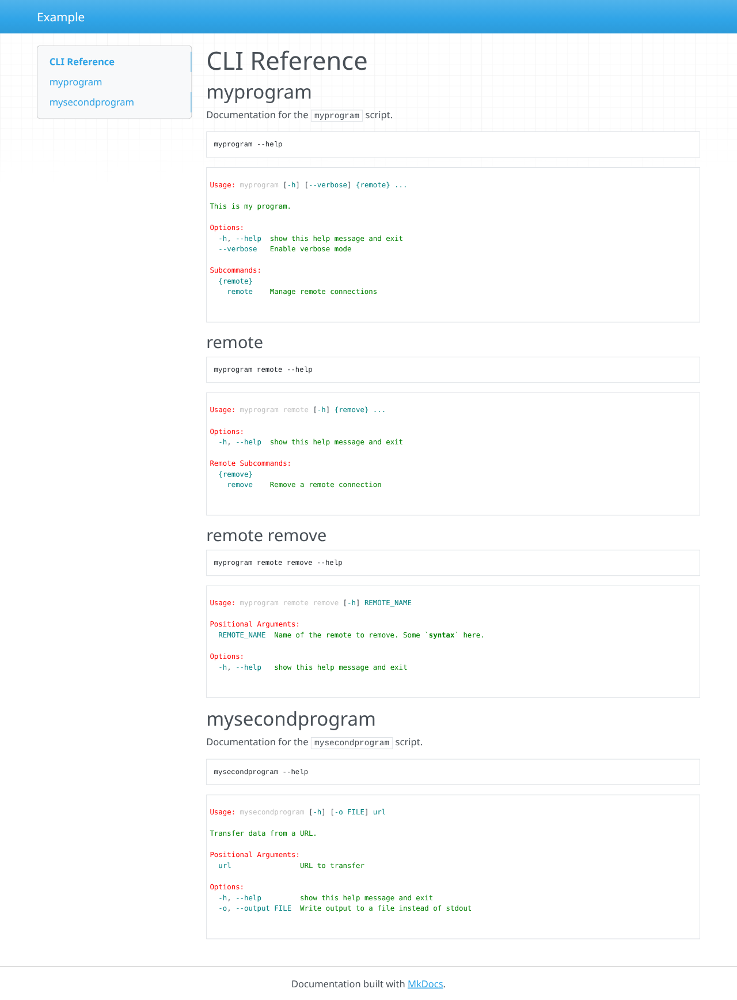

To generate CLI documentation for both console scripts in [parser.py](parser.py),
install both the plugin and the example distribution, then run:

```bash
pip install -e .. -e .
mkdocs serve
```

And visit [http://127.0.0.1:8000/cli/](http://127.0.0.1:8000/cli/).

The page documents `myprogram`, modeled after `git remote remove`, and
`mysecondprogram`, modeled after `curl`, with a URL argument and an output option.

To build static HTML instead, run `mkdocs build --strict`. The CLI page is written
to `site/cli/index.html`.

It should look something like this:
[](screenshot.png)

The plugin can be further configured see [mkdocs-custom.yml](mkdocs-custom.yml) for an example.
That configuration uses `order` to document `mysecondprogram` before `myprogram`.

```shell
mkdocs build -f mkdocs-custom.yml
```

And visit [http://127.0.0.1:8000/commands/](http://127.0.0.1:8000/commands/).
